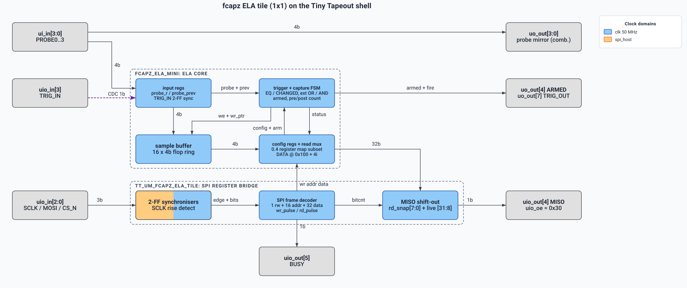

<!---

This file is used to generate your project datasheet. Please fill in the information below and delete any unused
sections.

You can also include images in this folder and reference them in the markdown. Each image must be less than
512 kb in size, and the combined size of all images must be less than 1 MB.
-->

## How it works

This is a compact, single-tile version of the embedded logic analyzer (ELA) from [fpgacapZero](https://github.com/lcapossio/fpgacapZero), with a 4-bit probe and a 16-sample capture buffer. The full upstream core does not fit in one tile, so the analyzer is a small reimplementation (`src/fcapz_ela_mini.v`) of a subset of the fpgacapZero 0.4 ELA register map, with the same capture behavior. Its ID registers (VERSION, FEATURES, COMPARE_CAPS) read the same as the full core built with this configuration (one trigger stage). As on that core, TRIG_MODE selects only value match or change detect, even though COMPARE_CAPS lists the modes its comparator can do.

It samples `ui_in[3:0]` on every clock into a ring buffer, through a 2-flop synchronizer on each bit. A trigger can fire on a value match (masked compare) or on any change of the masked bits, optionally combined (OR or AND) with the external `TRIG_IN` pin. `TRIG_IN` has the same synchronizer depth as the probe, so it lines up with the probe sample taken on the same clock. The buffer keeps a configurable number of samples from before the trigger, then fills the rest after it.

A host reads and writes the analyzer's registers over a SPI-style serial interface on the bidirectional pins. After reset the analyzer arms itself (`STARTUP_ARM=1`). `ARMED` is high from arming until the capture is done, including the samples after the trigger. `TRIG_OUT` pulses for one clock when the trigger fires.



## How to test

### Quick test on the demo board

The repository includes a self-test that runs on the demo board's RP2040 with the Tiny Tapeout MicroPython SDK. It needs no wiring or extra parts: the RP2040 drives the probe inputs, the serial pins and `TRIG_IN`, and clocks the project one edge at a time, so the result does not depend on timing. Set the input DIP switches off and unplug anything on the input and bidirectional PMOD headers first, so nothing fights the RP2040 on those pins.

1. Copy [`test/board/fcapz_ela_board.py`](https://github.com/lcapossio/tt_ela/blob/main/test/board/fcapz_ela_board.py) to the board's filesystem, for example with Thonny or `mpremote cp fcapz_ela_board.py :`.
2. In the board's REPL, run:

   ```python
   import fcapz_ela_board
   fcapz_ela_board.run()
   ```

The script selects the project, then runs eight tests: register read/write, ID registers, startup arm (with the probe low, then held high through reset), value trigger, change trigger, and external trigger in OR and AND mode. It prints `PASS` or `FAIL` for each and ends with `8/8 tests passed` on a working chip. The capture tests also print the captured samples. For example, the value-trigger test captures a 4-bit counter around the value `a`:

```
  samples: 6 7 8 9 a b c d e f 0 1
PASS test_capture
```

To use the analyzer from the REPL directly:

```python
ela = fcapz_ela_board.setup()
hex(ela.read(0x0000))   # VERSION, '0x44c41'
ela.write(0x0004, 0x1)  # arm
```

`setup()` uses manual clocking, so the project only advances when the script calls `ela.tick(n)`.

### Serial protocol

SPI mode 0, MSB first. The host changes `MOSI` while `SCLK` is low, and both sides sample on the rising edge of `SCLK`. `SCLK`, `MOSI` and `CS_N` are sampled by the project clock through 2-flop synchronizers, so the host must hold every level for at least **4 project clocks**:

- `SCLK` high and `SCLK` low each last at least 4 clocks (so `SCLK` is at most clk/8, 6.25 MHz at 50 MHz).
- Change `MOSI` only while `SCLK` is low, at least 4 clocks before the rising edge.
- Pull `CS_N` low at least 4 clocks before the first rising edge, raise it at least 4 clocks after the last one, and keep it high for at least 4 clocks between frames. A shorter `CS_N` high can be missed, and the next frame is then ignored.

Pull `CS_N` low, clock 49 bits, then raise `CS_N`:

| Bits  | Content |
|-------|---------|
| 0     | 1 = write, 0 = read |
| 1-16  | register address |
| 17-48 | write: data on `MOSI`. Read: data on `MISO` |

Clocks after bit 48 are ignored until `CS_N` rises. `BUSY` goes high at the first recognized `SCLK` rising edge and low once `CS_N` is high. `MISO` and `BUSY` are always driven (low outside a frame), so give `MISO` its own wire rather than sharing it with other SPI devices.

### Reset and inputs

`rst_n` is synchronous: hold it low for at least 4 rising edges of a running clock, with `CS_N` high and `SCLK` low. The demo board's reset does this. The probe inputs and `TRIG_IN` are asynchronous to the clock. A probe change that lands close to a clock edge can appear one sample later, and different bits of the same change can land in different samples. Hold `TRIG_IN` high for at least 2 clocks to be sure it is seen.

### Registers

Registers are 32 bits on the bus but store only the bits a 4-bit probe needs: a write keeps data bits `[3:0]` (fewer where noted), and the unused bits read as 0. CTRL reads as 0. Addresses not listed here, including TRIG_DELAY and TRIG_HOLDOFF, read as 0 and ignore writes.

| Address | Name | Notes |
|---------|------|-------|
| 0x0000 | VERSION | 0x00044C41: `[15:0]` core id 0x4C41 ("LA"), `[31:16]` fpgacapZero version 0.4 |
| 0x0004 | CTRL | write only: bit 0 = arm, bit 1 = reset capture (re-arms if STARTUP_ARM is set) |
| 0x0008 | STATUS | bit 0 armed, bit 1 triggered, bit 2 done (bit 3 overflow is always 0) |
| 0x000C / 0x0010 | SAMPLE_W / DEPTH | read 4 and 16 |
| 0x0014 / 0x0018 | PRETRIG / POSTTRIG | samples kept before / after the trigger sample. Keep PRETRIG + POSTTRIG <= 15 |
| 0x001C | CAPTURE_LEN | samples in the finished capture (PRETRIG + POSTTRIG + 1). Set when the trigger fires and kept until the next trigger, so read it after done |
| 0x0020 | TRIG_MODE | bit 1 = change detect, otherwise value match (default 1) |
| 0x0024 / 0x0028 | TRIG_VALUE / TRIG_MASK | compare value and mask |
| 0x002C | BURST_PTR | accepted for compatibility, no effect: the capture start is latched automatically |
| 0x003C | FEATURES | 0x00010141: one trigger stage, external trigger, one channel, one segment |
| 0x00A4 / 0x00B8 | NUM_CHAN / NUM_SEGMENTS | read 1 |
| 0x00BC / 0x00C8 | SEG_STATUS / SEG_START | 0x80000000 / buffer index of the capture start (like CAPTURE_LEN, valid after done) |
| 0x00E0 | COMPARE_CAPS | 0x000A01C3, same as the full core. Only value match and change detect can be selected, through TRIG_MODE |
| 0x00B4 | TRIG_EXT | bits `[1:0]`, `TRIG_IN` use: 0 = ignored (default), 1 = OR with internal trigger, 2 = AND |
| 0x00D8 | STARTUP_ARM | bit 0: arm automatically after reset and after a CTRL reset |
| 0x0100 + 4*i | DATA | sample i of the capture, oldest first. Reads 0 until done, and for i >= CAPTURE_LEN |

### Capturing

1. Write STARTUP_ARM = 0, then CTRL = 0x2. The analyzer is now idle. (With STARTUP_ARM = 1, the CTRL reset re-arms it, and a half-written trigger could fire and pulse `TRIG_OUT` while you configure.)
2. Set PRETRIG, POSTTRIG, TRIG_MODE, TRIG_VALUE, TRIG_MASK and TRIG_EXT (for example PRETRIG = 4, POSTTRIG = 7, TRIG_MODE = 1, TRIG_VALUE = 0xA, TRIG_MASK = 0xF).
3. Write CTRL = 0x1 to arm, and drive the signals to capture on `ui_in[3:0]`. Change the configuration only while not armed.
4. Poll STATUS until bit 2 (done) is set.
5. Read CAPTURE_LEN, then read DATA at 0x0100 + 4*i for i = 0 .. CAPTURE_LEN-1. The trigger sample is at index PRETRIG. Host code written for the full core can still write BURST_PTR first.

## External hardware

None required. The demo board's RP2040 can act as the host (see the quick test above), or any microcontroller with GPIO can. It needs four pins: `SCLK`, `MOSI` and `CS_N` as outputs, `MISO` as an input. To capture signals from outside the chip, connect them to `ui_in[3:0]` through the input PMOD header and make sure the RP2040 is not driving those pins (in the SDK, `RPMode.ASIC_MANUAL_INPUTS`). The self-test script itself uses `RPMode.ASIC_RP_CONTROL`, where the RP2040 drives `ui_in`, so external capture needs its own setup or an external SPI host.
